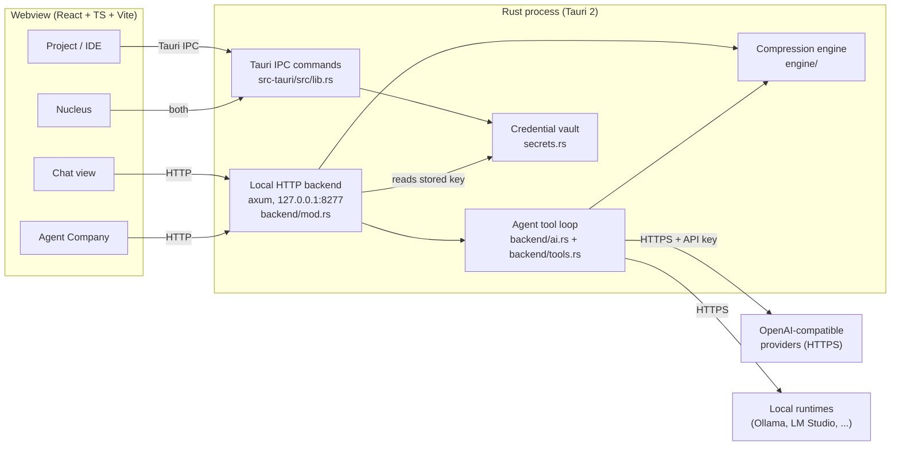
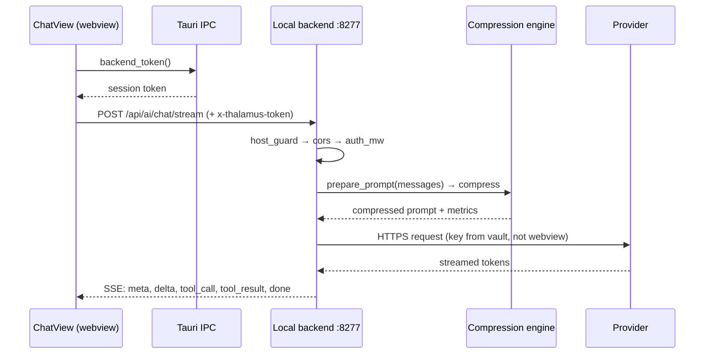
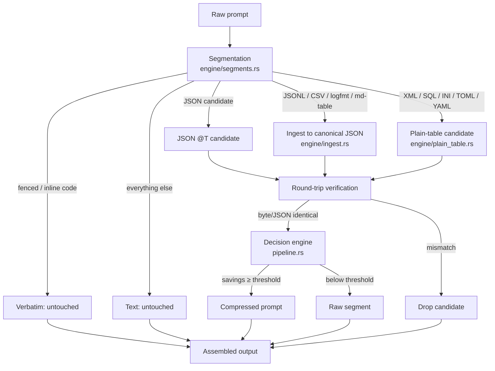

# Architecture

This document describes how Thalamus Desktop is put together. Every claim below
was checked against the code; file paths point at the implementation. Anything
this document could not verify is marked **DOĞRULANAMADI**.

## 1. System overview

Thalamus is a Tauri 2 desktop application with two processes:

- a **webview** running a React + TypeScript interface (`src/`),
- a **Rust process** (`src-tauri/`) that owns the compression engine, the agent
  loop, provider credentials, and a local HTTP server.

The webview never talks to a provider directly. It either calls the Rust side
over Tauri IPC (file/terminal/secret commands in `src-tauri/src/lib.rs`) or over
HTTP to `127.0.0.1:8277` (compression, chat, model discovery, agent runs).

Sources: `src-tauri/src/backend/mod.rs` (router and serve), `src-tauri/src/lib.rs`
(`run`, `AppState`, IPC commands), `src/services/aiClient.ts` (frontend client).

### The three surfaces

The interface has two top-level views plus a global command surface
(`src/App.tsx`, `currentView` is `'chat' | 'project'`):

| Surface | Where | What it is |
|---|---|---|
| Chat | `src/components/ChatView.tsx` | Streaming chat; each message carries token/cost metrics and compression state. |
| Project / IDE | `src/components/ProjectDashboard.tsx` | File explorer, editor, terminal, previews; a second pane (`paneMode`) hosts Agent Company. |
| Agent Company | `src/components/AgentCompany.tsx` | Plan view, node flow editor (`FlowEditorX6.tsx`), PixelOffice animation (`PixelOffice.tsx`), Agent Mesh (`AgentMesh.tsx`). |

Nucleus (`src/components/NucleusCommand.tsx`) is an overlay available from
anywhere, not a third view.

## 2. Local HTTP backend

`backend::serve` (`src-tauri/src/backend/mod.rs`) starts a single-threaded Tokio
runtime on a spawned OS thread and binds `127.0.0.1:<port>`. The port defaults
to 8277 and can be overridden with `THALAMUS_PORT`.

The router is wrapped in three layers, applied **after** all routes are
registered so that they cover every route:

1. `host_guard` — rejects any request whose `Host` header is not
   `127.0.0.1`, `localhost`, or `[::1]` (DNS-rebinding protection).
2. `cors` — an allowlist of `http://localhost:1420`, `http://127.0.0.1:1420`,
   `tauri://localhost`, and `http://tauri.localhost`.
3. `auth_mw` — requires `x-thalamus-token` to equal the process session token;
   `/api/health` is exempt.

Routes:

| Route | Handler | Purpose |
|---|---|---|
| `POST /api/compress` | `compress` | Run the compression engine, return metrics |
| `POST /api/ai/chat`, `/api/ai/chat/stream` | `ai::ai_chat*` | Chat, with tool loop and SSE streaming |
| `POST /api/ai/test` | `ai::ai_test` | Validate a provider endpoint/key |
| `POST /api/ai/models` | `local_models::local_models` | Discover local models |
| `POST/GET /api/ai/serve*` | `serve::*` | Start/stop/list managed local servers |
| `POST /api/repo/map` | `repo::repo_map` | Workspace structural map |
| `POST /api/agent/run`, `GET /api/agent/state`, `POST /api/agent/cancel` | `agent::*` | Multi-agent runs |

The session token is generated once per process from the OS CSPRNG
(`getrandom`, 32 bytes → 64 hex chars) and exposed to the webview through the
`backend_token` Tauri command. If generation fails the token is empty and every
authenticated route returns 401 (fail-closed).

## 3. Request flow for a chat message

Key points:

- `backend/ai.rs::prepare_prompt` builds the request; compression is applied
  invisibly to the messages that go to the model. The `meta` SSE event carries
  the token balance so the UI can show it.
- The provider key is read inside Rust (`resolve_api_key`); it is never placed in
  a request body the webview can see.
- When the model returns tool calls, `stream_tool_loop` executes them through
  `backend/tools.rs::execute` and feeds the results back until the model stops
  asking for tools.

## 4. Compression pipeline

`engine/pipeline.rs::process` is the public entry point. It runs in four stages:

Stage details:

1. **Segmentation** (`engine/segments.rs`). Fenced code blocks and inline code
   are `Verbatim`. Balanced-brace JSON is a `Json` candidate. Runs of
   JSONL/CSV/logfmt/markdown-table lines become `Data` (parsed by
   `engine/ingest.rs`). Runs that look like XML/SQL/INI/TOML/YAML become
   `Structured` only when `plain_table::compress` has produced a verified
   representation. Everything else is `Text` and is copied verbatim.
2. **Tiling guard.** `PromptSegmenter::tiles_exactly` verifies that the segments
   cover the input exactly once, in order. If not, compression is aborted and
   the raw prompt is returned.
3. **Transform + verify.** JSON goes through `engine/jscompress.rs`
   (`JsonCompressor`), which folds constant columns into `@T(...)`, uses
   dictionaries and prefixes, and decodes its own output for comparison.
   Plain-table kinds round-trip through `plain_table::decompress`. A candidate
   that does not reproduce the original at the JSON/byte level is dropped.
4. **Decision.** `DecisionEngine::evaluate` compares candidate token cost
   against the cost of the decoder instruction (`MINIMAL_DECODER_INSTRUCTION`)
   and a savings threshold. Plain-table kinds additionally pass the
   certification gate in `engine/certification.rs` (`MIN_SAVINGS_PCT = 25`).
   Nothing that fails is used; the raw segment is emitted instead.

The returned `CompressionMetrics` reports original/compressed tokens, savings
percentage, and `lossless_verified`.

## 5. Agent loop and tools

The tool loop lives in `backend/ai.rs` (`stream_tool_loop`). Tools are defined
once in `backend/tools.rs` (`specs` → OpenAI function-calling schemas) and
executed in the same file (`execute`).

- Tool set (13): `read_file`, `write_file`, `edit_file`, `list_dir`,
  `find_files`, `grep_search`, `get_code_body`, `repo_map`, `todo_write`,
  `dispatch_agent`, `web_search`, `read_page`, `run_command`.
- `run_command` is only listed when the permission mode is `auto` or
  `autonomous` (`shell_allowed`), and it strips sensitive environment variables
  before spawning the shell.
- Sub-agents (`dispatch_agent`) run with `read_only_specs`, cannot spawn further
  sub-agents, and their token usage is folded into the parent run.
- Each tool result is size-capped; a per-round character budget
  (`TOOL_RESULT_BUDGET`) stops a runaway round.
- File tools resolve paths with `safe_join`, which canonicalizes and rejects
  anything outside the workspace root.

Multi-agent orchestration (`agent/orchestrator.rs`) exposes
`run_pipeline`, `start_run`, and `cancel_run`; run state is held server-side in
`BackendState::agent_runs`.

## 6. Secrets

`secrets.rs` stores provider keys in the Windows Credential Manager, encrypted
with DPAPI (`CredProtectW`). Each write goes to a primary and a backup slot;
an unreadable blob is repaired from the backup and otherwise quarantined rather
than deleted. The threat model note at the top of the file is authoritative:
this protects against bulk credential dumps and offline analysis, not against a
malicious process running as the same Windows user.

## 7. Frontend structure

- `src/App.tsx` — shell, view switching, streaming chat orchestration.
- `src/services/` — HTTP clients (`aiClient.ts`, `agentClient.ts`,
  `ThalamusClient.ts`).
- `src/hooks/useThalamus.ts` — chat/state hook.
- `src/lib/` — pure helpers (diff, pricing, formatting, policy, i18n).
- `src/components/` — views and widgets.
- `src/lib/i18n.ts` — EN/TR dictionaries (`tr` is typed against `keyof en`).

## 8. Where things run

| Concern | Process | File |
|---|---|---|
| Tokenizer (`cl100k_base`) | Rust | `src-tauri/src/lib.rs`, `engine/fasttok.rs` |
| Compression | Rust | `engine/` |
| Provider calls | Rust | `backend/ai.rs` |
| Agent tools | Rust | `backend/tools.rs`, `backend/repo.rs` |
| Terminal (ConPTY) | Rust | `src-tauri/src/lib.rs` (`start_terminal`) |
| File I/O in the IDE | Rust | `src-tauri/src/lib.rs` |
| UI rendering | Webview | `src/` |

**DOĞRULANAMADI:** the exact latency split between the webview and the backend
during streaming was not measured in this pass; see `docs/benchmarks.md` for
what is and is not measured.
